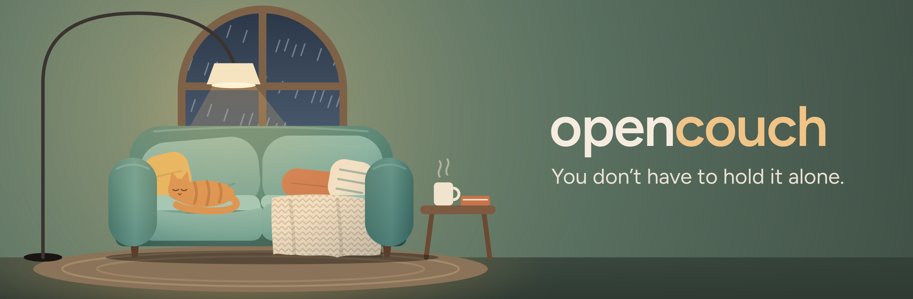

<p align="center">
  
</p>

# OpenCouch

A guided self-help program for anxiety, with an AI coach that helps people
practise skills instead of reassuring them. This branch is a from-scratch
rewrite; see
[#356](https://github.com/whanyu1212/OpenCouch/issues/356) for the architecture
plan. The previous implementation lives on `main` for reference.

## Layout

| Path | What |
|---|---|
| `apps/agent` | Python agent service: FastAPI + [Pydantic AI](https://pydantic.dev/docs/ai/), served over [AG-UI](https://docs.ag-ui.com) |
| `apps/web` | Next.js frontend using `@ag-ui/client` |

## Local development

Prerequisites: [uv](https://docs.astral.sh/uv/), Node 22 with pnpm, Docker.

```bash
# Agent on http://localhost:8080 (needs OPENAI_API_KEY, AI_GATEWAY_API_KEY and
# NEON_AUTH_BASE_URL in apps/agent/.env)
cp apps/agent/.env.example apps/agent/.env
# --env-file exports the key; the settings loader alone doesn't pass it to the
# OpenAI client.
cd apps/agent && uv sync && uv run --env-file .env opencouch-agent

# Web on http://localhost:3000 (needs NEON_AUTH_BASE_URL and
# NEON_AUTH_COOKIE_SECRET in apps/web/.env.local)
pnpm install
cp apps/web/.env.example apps/web/.env.local
pnpm dev:web
```

People sign in with [Neon Auth](https://neon.com/docs/auth/overview) (managed
Better Auth on the project's Neon database), using a one-time code sent to
their email. The web app signs them in and sends a short-lived Neon Auth token
with every request; the agent checks it against Neon Auth's published keys and
won't start without `NEON_AUTH_BASE_URL`. Sign-in lives in its own Neon project,
`opencouch-auth` (Singapore), apart from the Vercel-managed conversation
database: its `main` branch serves the demo and its `dev` branch local
development (`neon neon-auth status --branch dev` shows the URL). Only email
codes are on; password and Google sign-in are off.

The demo is a private beta. The sign-in page offers two ways in: "I've been
invited", where only invited addresses are sent a code (everyone sees the same
reply, so the page never says who's invited), and "Request early access",
which stores just the email so it can be invited by hand. The agent also
checks the verified email on every request, so it stays the gate even if
someone calls Neon Auth directly.

- **Invite or remove someone:** edit `OPENCOUCH_BETA_INVITES` (comma-separated)
  on Vercel, where both services read it, and redeploy. With none set, nobody
  gets in. For local runs with the test model, `OPENCOUCH_BETA_OPEN=true` lets
  everyone in.
- **See or remove requests for early access:** `scripts/access_requests.py`
  in `apps/agent` (`list`, `remove <email>`); its docstring shows how to point
  it at the demo's database.

Every turn is screened by Jev through Vercel AI Gateway before the agent
replies, so the agent won't start without `AI_GATEWAY_API_KEY`. Without API
keys, run it against Pydantic AI's test model with a fake Jev:
`OPENCOUCH_MODEL=test OPENCOUCH_FAKE_JEV=true`. The fake reads every message as
no risk, so it is refused with any other model. `OPENCOUCH_FAKE_AUTH=true` does
the same for sign-in: every request is one local user, with the test model only.

Conversation history is stored in Postgres when `OPENCOUCH_DATABASE_URL` (or
`DATABASE_URL`) is set, and kept in memory (lost on restart) otherwise. To run
the Postgres-backed tests locally, set `OPENCOUCH_TEST_POSTGRES_URL`.

To run Postgres and the agent in Docker instead:

```bash
docker compose up --build
```

## The private demo

The demo runs on Vercel as one project with two
[Services](https://vercel.com/docs/services), configured in `vercel.json`:
`apps/agent` serves `/api/*` and `apps/web` serves everything else, so the
browser calls the agent on the same site (`apps/web/.env.production`).

- **Access:** Deployment Protection with Vercel Authentication covers every
  deployment, the agent's routes included, so there is no public URL. Testers
  get the project's shareable link (Hobby allows one per account), which can be
  revoked from the deployment's Share menu. Testers also sign in with Neon
  Auth, and each conversation belongs to the tester who started it: anyone
  else gets a 404.
- **Environment variables:** `OPENAI_API_KEY`, `AI_GATEWAY_API_KEY`,
  `DATABASE_URL` from the Neon database added through the Vercel Marketplace,
  `NEON_AUTH_BASE_URL` for both services, `NEON_AUTH_COOKIE_SECRET` (32+
  random bytes, `openssl rand -base64 32`) for the web app, and
  `OPENCOUCH_BETA_INVITES`. Never `OPENCOUCH_FAKE_JEV`, `OPENCOUCH_FAKE_AUTH`
  or `OPENCOUCH_BETA_OPEN`.
- **Deploying:** `vercel deploy --target preview` for a preview, then
  `vercel deploy --prod` for production. A smoke test after deploying: send a
  calm message and a crisis message, and check the crisis one gets the resource
  card.

## Checks

```bash
cd apps/agent && uv run ruff check . && uv run mypy src tests evals scripts && uv run pytest
pnpm lint:web && pnpm build:web
```
